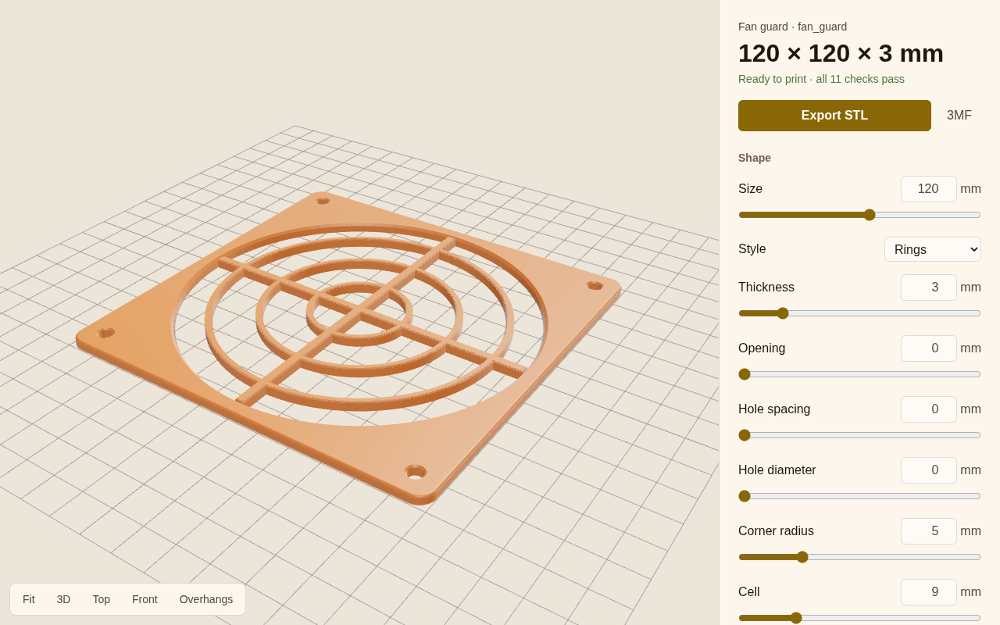

# Studio

Gantrel Studio is a local 3D viewport for one smoothstone job. It shows the part stone built, lets you change the recipe's settings with controls, rebuilds, and follows edits an agent makes from chat as they land on disk.



## Start it

```
gantrel-studio [--job DIR] [--port 7342] [--host 127.0.0.1] [--no-open]
```

- `--job` is the stone job folder (default `./stone-job`).
- `--port` is the first port to try. If it is taken, the next 10 are tried.
- `--no-open` skips opening a browser.

It prints exactly one line, then serves until you stop it with Ctrl+C:

```
Gantrel Studio: http://127.0.0.1:7342/?t=<token>
```

The token is new on every launch. Open that exact URL; the page needs the token for every call it makes.

### In the background

```
gantrel-studio --job ./stone-job --detach
gantrel-studio --job ./stone-job --stop
```

`--detach` starts the studio in its own session, prints the same line plus a ready Markdown link (`Give the person this link: [Open Gantrel Studio](...)`, since Local Studio makes only Markdown links clickable), and returns at once, so an agent's shell call doesn't hang. Run it again for the same job and it prints the link of the studio already running instead of starting another. `--stop` ends it. The background studio keeps its port and key in `~/.cache/gantrel-studio/<job hash>.json` (mode 0600, in a 0700 folder) and its output in the matching `.log` (also 0600). The state file is removed when the studio stops, and the key is never written to the log.

It needs `stone` with `stone show <recipe> --json` (smoothstone after baney75/smoothstone#11) on `PATH`.

## Security rules

- It binds `127.0.0.1` by default, so other computers can't reach it.
- It answers only requests whose `Host` header is `127.0.0.1:<port>` or `localhost:<port>`. Anything else gets 403, which blocks DNS rebinding from a web page.
- Every `/api/*` request needs the launch token, as `?t=<token>` or the `X-Gantrel-Token` header. Without it the answer is 403.
- A POST with an `Origin` header that is not `http://127.0.0.1:<port>` or `http://localhost:<port>` gets 403.
- Every setting is checked against the recipe's schema before stone runs: numbers and whole numbers within min and max, choices from the list, true or false for switches, text up to 200 characters with no control characters. Unknown names are refused. Picture settings name files on disk, so they are set from chat with `stone image`, never from the page.
- stone always runs from an argument list, never through a shell.
- Request logging is off, so the token is never logged after the startup line. Responses send `Referrer-Policy: no-referrer` so the token in the page URL is not passed to other sites.

## API

All JSON unless noted. Every `/api/*` path needs the token.

| Call | What it does |
| --- | --- |
| `GET /`, `GET /static/<path>` | The page from `src/gantrel_studio/web/`. |
| `GET /api/state` | The job: request, recipe, schema, current params, status, check, part (`url`, `size_mm`, `faces`), `building`, `error` and `version`. |
| `GET /api/events` | Server-Sent Events. An `event: state` message at connect and each time `version` changes, and a keepalive comment every 15 s. |
| `GET /api/part.stl`, `GET /api/preview.png` | The built part and its preview. |
| `POST /api/params` | `{"params": {"size": 60}}`: check, `stone set`, then `stone build`. Answers 202 at once; watch the events. |
| `POST /api/reset` | `stone set --reset`, then build. |
| `GET /api/export/part.stl`, `GET /api/export/part.3mf` | Downloads named after the recipe. The 3MF is written from the STL in millimeters. |
| `GET /api/printers` | Configured printers from `gantrel-printer` (name and kind), read only. |

Builds run one at a time. Settings sent while a build runs are merged, and at most one more build follows with the latest values. When stone exits with an error, `error` holds the last 20 lines of its output. A part that built but fails a print check is not an error: `check` carries the failed check and its advice, and the page shows which one.

The studio watches `brief.md`, `status.json`, `plan.json`, `build/params.json`, `build/check.json` and `build/part.stl` every 250 ms, so a change made from chat shows up on the page without a reload.
